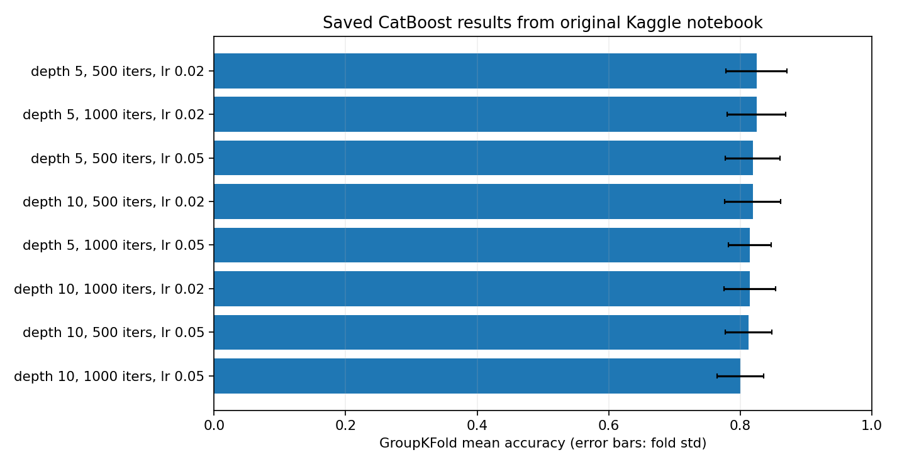

# Titanic survival prediction

**Python | CatBoost | Feature engineering | GroupKFold | Kaggle**

A Titanic survival classification project built around feature engineering and ticket-grouped cross-validation. The repository contains a single cleaned Jupyter notebook, reusable Python scripts for model evaluation and submission generation, and automated tests.

The work uses the [Kaggle Titanic competition](https://www.kaggle.com/competitions/titanic). The official train/test CSV files are **not included**.

## Model and features

The classifier is CatBoost with eight features:

| Feature | Preparation |
| --- | --- |
| `Pclass`, `Sex`, `Embarked` | Passenger class and categorical attributes |
| `Age` | Missing ages imputed using median age per title from the training fold; global median fallback |
| `Title` | Extracted from passenger name and normalized |
| `FamilySize` | `SibSp + Parch + 1` |
| `AgeClass` | `Age * Pclass` |
| `Fare` | Missing values filled using the training-fold median |

Preprocessing statistics are calculated **separately for each training fold** to avoid using validation observations during imputation. Ticket numbers define groups for five-fold `GroupKFold`, helping keep passengers who share a ticket from appearing in both training and validation folds. Ticket is not used as a predictive feature.

## Recorded experiments

The saved Kaggle notebook output contained eight CatBoost configurations (depth 5/10, 500/1000 iterations, learning rate 0.02/0.05), evaluated using five ticket-grouped folds.

| Metric | Best recorded configuration |
| --- | --- |
| Mean CV accuracy | **0.8248 (82.48%)** |
| Standard deviation across folds | 0.0460 |
| Depth | 5 |
| Iterations | 500 |
| Learning rate | 0.02 |



All eight recorded settings and values are in [`results/recorded_cv_results.csv`](results/recorded_cv_results.csv). **These are saved cross-validation results, not independently reproduced scores and not Kaggle leaderboard results.** The cleaned pipeline consistently uses `Fare` during validation and final training, which fixes a feature-set mismatch in the original experimentation. New scores and predictions may differ.

## Run the project

**Requirements:** Python 3.10 or later. Download `train.csv` and `test.csv` from the [Kaggle competition data page](https://www.kaggle.com/competitions/titanic/data) and place them in `data/raw/`.

```bash
python -m venv .venv
# Linux/macOS: source .venv/bin/activate
# Windows PowerShell: .venv\Scripts\Activate.ps1
pip install -r requirements.txt

# Fast validation smoke check: one small configuration, three folds
python evaluate.py --quick --folds 3

# Full parameter comparison: eight configurations, five folds
python evaluate.py

# Train selected CatBoost parameters and save outputs/submission.csv
python train.py
```

To run the notebook, install its optional dependencies and open [`notebooks/titanic_workflow.ipynb`](notebooks/titanic_workflow.ipynb):

```bash
pip install -r requirements-notebook.txt
jupyter notebook
```

To run the automated checks without downloading Titanic data:

```bash
pip install -r requirements-dev.txt
python -m pytest -q
```

The tests construct fictional passenger records. Passing them verifies preprocessing and submission structure, **not** Kaggle competition accuracy.

## Repository layout

```text
.
├── README.md
├── train.py                          # Train on competition data and write predictions
├── evaluate.py                       # Ticket-grouped CatBoost parameter comparison
├── titanic_survival/
│   ├── __init__.py
│   └── pipeline.py                   # Shared preprocessing, training and evaluation
├── notebooks/
│   └── titanic_workflow.ipynb        # Cleaned project walkthrough
├── results/
│   └── recorded_cv_results.csv       # Saved experimental results
├── docs/
│   ├── cv_comparison.png
│   └── methodology.md                # Validation choices and limitations
├── tests/
│   ├── conftest.py
│   └── test_pipeline.py
├── data/
│   └── README.md                     # Download instructions
├── requirements.txt
├── requirements-dev.txt
├── requirements-notebook.txt
├── .gitignore
└── .github/workflows/tests.yml
```

## Limitations

- The Kaggle Titanic dataset is relatively small. Cross-validation accuracy is not a guarantee of performance on unseen passengers.
- Grouping by `Ticket` avoids exact ticket overlap but does not eliminate every possible family-related correlation.
- The recorded best CV score was obtained after comparing settings on the same dataset, so it is not an unbiased final test estimate.
- The competition test labels are not public. No independently verified leaderboard score is claimed here.

See [methodology and limitations](docs/methodology.md) for further details.
